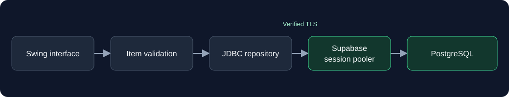

<div align="center">

# 📦 Stockroom

### Small-store inventory. Built with Java. Stored in Supabase.

A focused desktop application for managing items, quantities, and stock status.


**Software Construction · Open-Ended Lab**

[Features](#features) · [Quick start](#quick-start) · [Architecture](#architecture) · [Testing](#testing) · [Documentation](#documentation)

</div>

---

## Overview

Stockroom pairs a Java Swing interface with persistent PostgreSQL storage, validated input, and a Git history that records development feature by feature. Built for the Software Construction OEL, it demonstrates Java classes, JDBC, background tasks, database constraints, automated checks, and generated API documentation.

## Features

| Feature | What it does |
| :--- | :--- |
| **Add items** | Save a name, whole-number quantity, and stock status. |
| **View inventory** | Load saved records, refresh the table, and sort columns. |
| **Edit records** | Select a row and update its details. |
| **Delete safely** | Confirm before removing the selected item. |
| **Set status** | Choose **In Stock**, **Low Stock**, or **Out of Stock**. |
| **Validate input** | Reject blank or oversized names and invalid quantities. |
| **Handle errors** | Report connection failures and missing records. |
| **Stay responsive** | Perform database operations in background Swing workers. |

> Stock status is selected manually. Quantity changes do not automatically recalculate it because the assignment specifies no stock thresholds.

## Quick start

### 1. Prerequisites

- **JDK 21**, with `java`, `javac`, and `javadoc` on your PATH.
- **PowerShell** and **Git**. The build scripts target Windows.
- A **Supabase project** and PostgreSQL connection credentials.
- **Node.js and npm** for the Supabase CLI migration script.

The build script downloads the PostgreSQL JDBC driver on its first run. Maven and Gradle are not required.

### 2. Clone and test

```powershell
git clone https://github.com/Saad-i514/SC-OEL.git
cd SC-OEL
.\build.ps1 test
```

This compiles the application and runs validation checks without connecting to the database.

### 3. Configure the database

```powershell
Copy-Item db.properties.example db.properties
```

Edit `db.properties` using the **Session pooler** settings from your Supabase project's **Connect** dialog:

```properties
url=jdbc:postgresql://YOUR_POOLER_HOST:5432/postgres?sslmode=verify-full&sslrootcert=certs/supabase-ca.crt&connectTimeout=10&socketTimeout=20
user=postgres.YOUR_PROJECT_REF
password=YOUR_DATABASE_PASSWORD
```

Use your project's actual pooler hostname. The session pooler on port `5432` supports connections when the direct IPv6 endpoint is unreachable. JDBC uses database credentials, so a publishable API key is unnecessary. The included public CA certificate enables certificate-chain and hostname verification.

> **Keep credentials local.** `db.properties` is ignored by Git. Exclude it from source ZIPs and never distribute it with the application.

### 4. Apply the schema and launch

```powershell
.\configure-db.ps1
.\build.ps1 integration
.\build.ps1 run
```

The configuration script applies pending migrations through the Supabase CLI. Integration tests create a uniquely named item, verify CRUD operations, and clean up that record.

## Using Stockroom

1. Enter an item name, quantity, and status; select **Add item**.
2. Select a table row to load its details into the editor.
3. Edit the fields and select **Save changes**.
4. Select **Delete item** and confirm to remove the record.
5. Use **Refresh** to reload records or **Clear selection** to reset the editor.

Names are trimmed and must contain 1–200 characters. Quantities must be whole numbers from `0` to `2147483647`.

## Commands

| Command | Purpose |
| :--- | :--- |
| `.\build.ps1 build` | Compile with compiler warnings enabled. |
| `.\build.ps1 test` | Run local validation checks. |
| `.\build.ps1 integration` | Run validation and live database CRUD checks. |
| `.\build.ps1 run` | Compile and launch the application. |
| `.\build.ps1 docs` | Generate HTML Javadoc. |
| `.\configure-db.ps1` | Apply pending database migrations. |

### IDE setup

Open the project in IntelliJ IDEA, Eclipse, or NetBeans. Select **JDK 21**, mark `src` as the source directory, and add `lib/postgresql-42.7.14.jar` as a library after running the build script once. Set the working directory to the repository root and run **`inventory.InventoryApp`**.

## Architecture



| Component | Responsibility |
| :--- | :--- |
| `Item` | Immutable record; normalizes and validates input. |
| `InventoryRepository` | Prepared-statement CRUD and database resource management. |
| `InventoryApp` | Table, editor, selection, and background operations. |
| SQL migration | Table definition, constraints, and API access restrictions. |

Fetched records are held in an `ArrayList` snapshot. PostgreSQL stores the durable inventory; connection failures do not silently switch to temporary storage.

### Database model

| Column | Type | Rules |
| :--- | :--- | :--- |
| `id` | `bigint` | Generated identity and primary key. |
| `name` | `text` | Required; trimmed length from 1 to 200. |
| `quantity` | `integer` | Required; zero or greater. |
| `status` | `text` | One of the three supported labels. |

The migration enables row-level security and revokes table access from `anon` and `authenticated`. This version is for a **trusted operator on a private desktop** using database credentials. It does not provide end-user login or permissions for public distribution.

## Project structure

```text
SC-OEL/
├── src/inventory/          # Model, repository, and Swing application
├── tests/inventory/        # Validation and live CRUD checks
├── supabase/migrations/    # Versioned database schema
├── certs/                 # Public CA certificate and its source
├── docs/
│   ├── javadoc/           # Generated HTML API documentation
│   ├── design.md          # Implementation decisions
│   └── verification.md    # Results and manual demo checklist
├── build.ps1              # Compile, test, run, and generate docs
├── configure-db.ps1       # Supabase CLI migration script
├── db.properties.example  # Credential-free connection template
└── 30B.pdf                # Original assignment brief
```

`build/`, `lib/`, and local `db.properties` are excluded from Git.

## Testing

| Development check | Result |
| :--- | :---: |
| Java 21 compilation | ✅ Passed |
| Valid input, whitespace normalization, and zero quantity | ✅ Passed |
| Blank names and invalid, negative, fractional, or overflowing quantities | ✅ Passed |
| Unsupported status and oversized names | ✅ Passed |
| Supabase CLI migration | ✅ Passed |
| Live add, list, update, and delete | ✅ Passed |
| Updates/deletions of missing records | ✅ Passed |
| Javadoc generation | ✅ Passed |
| GUI walkthrough and Javadoc browser review | ⏳ Pending |

These are recorded local test results, not automated CI status. See the [verification record](docs/verification.md) for details and the manual demonstration checklist.

## Documentation

- [Design notes](docs/design.md) — structure, storage, and implementation choices.
- [Verification record](docs/verification.md) — tested behavior and remaining checks.
- [Generated Javadoc](docs/javadoc/index.html) — clone the repository and open this file locally in a browser.
- [Assignment brief](30B.pdf) — requirements and assessment criteria.

Regenerate and open the API documentation:

```powershell
.\build.ps1 docs
Start-Process .\docs\javadoc\index.html
```

## Git history

Meaningful commits cover requirements, validation, database persistence, the Swing interface, documentation, and verified Supabase connectivity.

```powershell
git log --oneline --graph --all
git status
git show --stat HEAD
```

Published at [Saad-i514/SC-OEL](https://github.com/Saad-i514/SC-OEL) on `main`.

## OEL submission checklist

- [x] Java Swing application source
- [x] Supabase persistence and versioned migration
- [x] Meaningful Git revisions and GitHub upload
- [x] Validation and live CRUD checks
- [x] Generated Javadoc included in the repository
- [ ] Add the two group members' details to the final report
- [ ] Complete the IDE demonstration and GUI walkthrough
- [ ] Capture actual application screenshots
- [ ] Review generated Javadoc in a browser
- [ ] Prepare the detailed report PDF and credential-free source ZIP

---

<div align="center">

**Stockroom · SC-OEL**

Java desktop development, persistent storage, and a traceable construction workflow.

</div>
